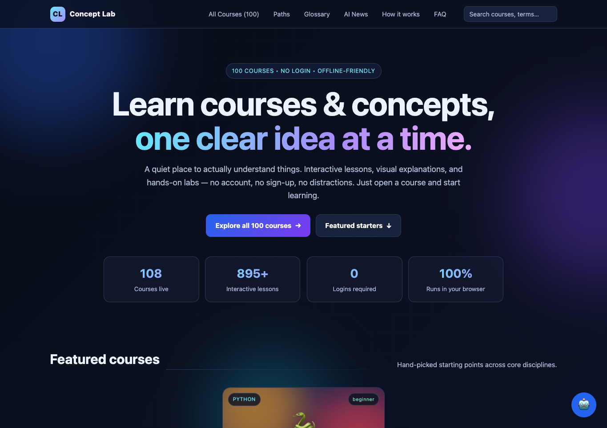
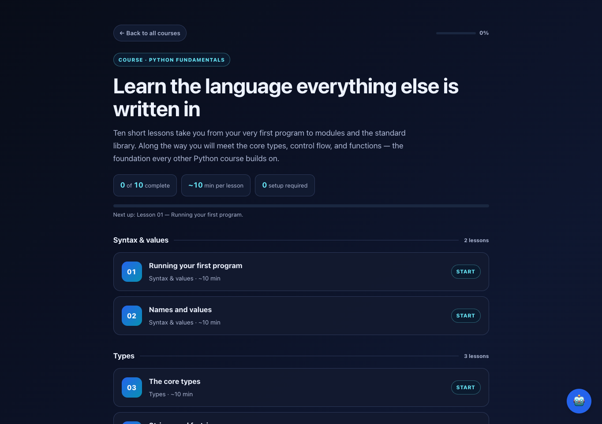
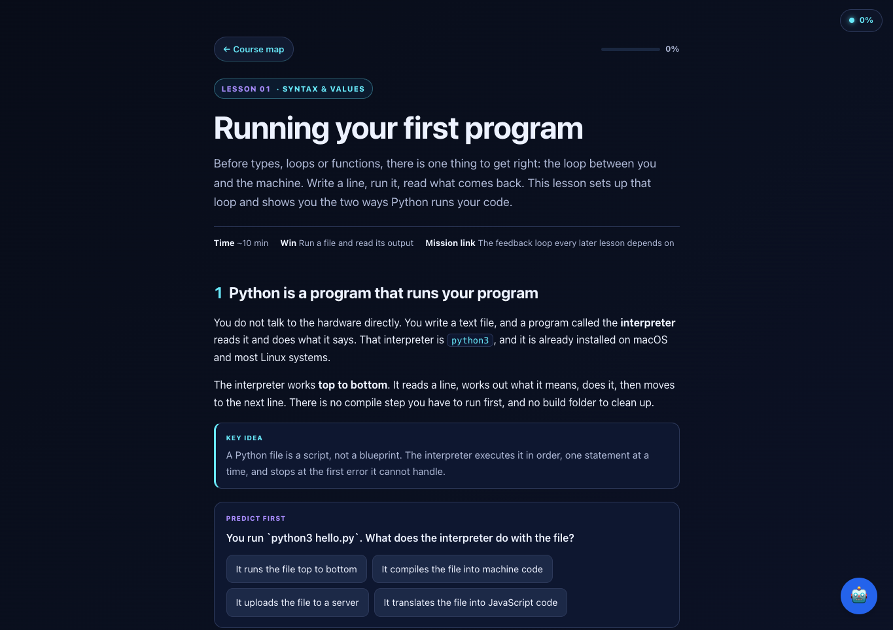

# Concept Lab

### Learn courses and concepts, one clear idea at a time.

Concept Lab is a free, no-login learning space for people who want to understand how technology works. Explore a broad curriculum through short explanations, interactive lessons, visual models, and hands-on knowledge checks—all in your browser.

**[Open Concept Lab](https://greatbilal1.github.io/concept-lab/)** · **[Browse all 100+ courses](https://greatbilal1.github.io/concept-lab/courses.html)** · **[Learning paths](https://greatbilal1.github.io/concept-lab/#paths)** · **[AI blog](https://greatbilal1.github.io/concept-lab/news.html)** · **[Glossary](https://greatbilal1.github.io/concept-lab/glossary.html)**



## Why Concept Lab

| | |
| --- | --- |
| **100+ courses** | From computer science foundations to production AI, security, and distributed systems |
| **900+ interactive lessons** | Short, focused, and built to be finished in one sitting |
| **14 learning paths** | Guided tracks that tell you what to learn next |
| **1,600+ glossary terms** | Every concept cross-linked back to the course that teaches it |
| **100 AI articles** | A running blog on applied AI engineering |
| **0 logins** | No account, no email, no tracking, no backend |

## Learn by exploring

- **Follow a learning path** or jump straight into a topic, from programming foundations to AI, security, and distributed systems.
- **Make ideas visible** with diagrams, animations, and interactive examples.
- **Check your understanding** with prediction prompts, quizzes, and fill-in exercises.
- **Pick up where you left off** with progress saved in your browser.
- **Learn without an account.** Core course content runs locally and is designed to work offline once available on your device.

<p align="center">
  
  
</p>

## Learning paths

Not sure where to start? Each path is an ordered track through the catalog, from first principles to job-ready depth.

| Path | What it covers |
| --- | --- |
| 🐍 **Python Developer** | Language fundamentals, modules, type hints, errors, files and JSON |
| 🧱 **CS Foundations** | How computers work, data structures, algorithms, Big-O, complexity |
| 🌐 **Frontend Engineer** | HTML and the DOM, CSS layout, JavaScript, browser events and async |
| 🛠️ **Backend Engineer** | HTTP, REST APIs, databases, ORMs, authentication, sessions |
| 🚀 **DevOps** | Command line, Git, Docker, CI/CD, Kubernetes, infrastructure as code |
| 📊 **Data Analyst** | Python for data, SQL, PostgreSQL, data pipelines and ETL |
| 🤖 **AI Engineer** | LLMs, embeddings, RAG, function calling, evaluation, observability |
| 🧠 **AI App Builder** | First LLM app, prompt engineering, context, memory, guardrails |
| 🔐 **Security Engineer** | Cybersecurity fundamentals, secrets, identity, prompt injection |
| 🧩 **Full-Stack Developer** | Frontend and backend together, end to end |
| 🏛️ **Software Architect** | Design patterns, separation of concerns, distributed systems |
| ✅ **Quality & SDET** | Testing, debugging, code review, refactoring, technical debt |
| 🗄️ **Data Engineer** | Pipelines, warehouses, streaming, orchestration at scale |
| ⚡ **Vibe Coding** | Working effectively with AI coding agents on real projects |

## The AI blog

[`news.html`](https://greatbilal1.github.io/concept-lab/news.html) is a running blog of 100 articles on applied AI engineering — the practical side of building with models. Topics include:

- **AI Guardrails** and adversarial defense
- **Multi-agent swarms** and agent architecture
- **Agent protocols** and tool use
- **Vector databases** and retrieval at scale
- **Context caching** and prompt compilers
- **On-device inference** and latency optimization

Each article is a self-contained page with a reading time, category, and author card.

## Run it locally

No build step or package installation is required. Clone the repository, then open `index.html` in a modern browser:

```bash
git clone https://github.com/greatbilal1/concept-lab.git
cd concept-lab
open index.html
```

On Windows, open `index.html` from File Explorer. If you prefer a local web server, for example:

```bash
python3 -m http.server 8000
```

Then visit [http://localhost:8000](http://localhost:8000).

## What's inside

| Path | Purpose |
| --- | --- |
| `index.html` | Home page, featured courses, and learning paths |
| `courses.html` | Full course catalog with level and tier filters |
| `glossary.html` | 1,600+ cross-linked terms |
| `news.html`, `article.html` | AI blog index and article reader |
| `courses/` | Course hubs, lessons, and reference material |
| `data/` | Course catalog, learning paths, glossary, and news data |
| `assets/css/` | Design tokens, site styles, explainer animations, motion layer |
| `assets/js/` | Renderer, search, motion engine, and the optional Labby assistant |
| `screenshots/` | README screenshots |

## Add or improve a course

Course pages are self-contained HTML and use shared assets from the repository. Course metadata and the catalog live in `data/courses.js`; learning paths live in `data/paths.js`. Authoring helpers and validation guidance are in [`tools/README.md`](tools/README.md).

If you contribute, keep lessons clear, focused, and interactive. Before submitting course changes, run the repository validator:

```bash
node tools/validate.js
```

## Privacy and optional AI assistant

Concept Lab does not require an account. Course progress is kept in your browser. The optional Labby assistant is different from the core learning experience: if you configure it, your provider API key is stored in that browser's local storage and requests are sent directly from your browser to the provider you select.

**Do not put a personal API key in the source code, README, screenshots, or a public GitHub repository.** A browser-based app cannot keep a shared provider secret private. Anyone using a publicly hosted copy should supply their own key, or leave the optional assistant unconfigured. Local storage is specific to a browser profile, so avoid entering a key on a shared device.

## Built with

HTML, CSS, and vanilla JavaScript. The core site has no build step and no required account or backend.

## License

No license is currently specified. Unless a license is added, the repository's contents are not granted for reuse under an open-source license.
